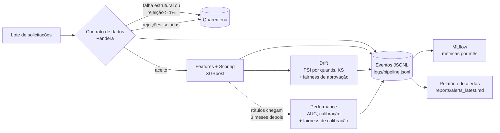

# Projeto Credit Scoring — Observabilidade, Drift, Qualidade de Dados e Governança

Tech Challenge — Fase 4 · PosTech MLET (FIAP)

Uma fintech de crédito tem um modelo de *credit scoring* em produção, e a diretoria suspeita de **degradação silenciosa** após mudanças econômicas. Este projeto constrói a camada de **sustentação e confiabilidade** desse modelo: contratos de dados que barram lixo na entrada, detecção estatística de drift, observabilidade do pipeline e governança sob a LGPD, incluindo uma análise causal da degradação.

## Resultado em três linhas

- Num choque macroeconômico simulado (inflação, juros, novo perfil de clientes e desemprego), o **data drift alertou 2 meses antes** de a degradação ser confirmada pelos rótulos de inadimplência.
- O **prediction drift (PSI do score) nunca alertou**, enquanto a inadimplência da carteira aprovada passou de **3,9% para 8,6%**: sem monitorar rótulos e calibração, a degradação é literalmente silenciosa.
- **Retirar a idade do modelo piorou a situação dos jovens** (AIR 0,575 → 0,517): atributos protegidos devem ser medidos e monitorados, não apenas removidos.

## Sumário

- [Projeto Credit Scoring — Observabilidade, Drift, Qualidade de Dados e Governança](#projeto-credit-scoring--observabilidade-drift-qualidade-de-dados-e-governança)
  - [Resultado em três linhas](#resultado-em-três-linhas)
  - [Sumário](#sumário)
  - [Como reproduzir](#como-reproduzir)
  - [Arquitetura](#arquitetura)
  - [Etapa 1 — Validação de dados e contratos](#etapa-1--validação-de-dados-e-contratos)
  - [Etapa 2 — Simulação e detecção de drift](#etapa-2--simulação-e-detecção-de-drift)
  - [Etapa 3 — Observabilidade](#etapa-3--observabilidade)
  - [Etapa 4 — Governança (LGPD) e causalidade](#etapa-4--governança-lgpd-e-causalidade)
    - [Dados pessoais e minimização (doc 1)](#dados-pessoais-e-minimização-doc-1)
    - [Bases legais e explicabilidade (doc 2)](#bases-legais-e-explicabilidade-doc-2)
    - [Retenção, direitos e segurança (doc 3)](#retenção-direitos-e-segurança-doc-3)
    - [Viés (doc 4)](#viés-doc-4)
    - [Causalidade e resposta (doc 5)](#causalidade-e-resposta-doc-5)
  - [Decisões e lições](#decisões-e-lições)
  - [Vídeo](#vídeo)

---

## Como reproduzir

**Requisitos:** Python 3.12, [uv](https://docs.astral.sh/uv/), conta no Kaggle com as regras da competição *Home Credit Default Risk* aceitas.

```powershell
# 1. Ambiente
uv sync
uv run pre-commit install --hook-type pre-commit --hook-type commit-msg

# 2. Dados (token em https://www.kaggle.com/settings/api)
$env:KAGGLE_API_TOKEN = "<seu_token>"
uvx kaggle competitions download -c home-credit-default-risk -f application_train.csv -p data/raw
# se vier compactado: Expand-Archive data/raw/<arquivo>.zip -DestinationPath data/raw

# 3. Referência e modelo
uv run python -m credit_scoring.data.ingest              # 122 → 21 colunas; split referência/produção
uv run python -m credit_scoring.data.clean_reference     # limpeza via contrato
uv run python -m credit_scoring.model.train              # baseline (LogReg × XGBoost por CV)

# 4. Simulação e pipeline
uv run python -m credit_scoring.drift.simulate           # 7 meses de produção sob choque
uv run python -m credit_scoring.pipeline --flush         # 1ª passada: gera os lotes pontuados
uv run python -m credit_scoring.governance.fairness      # auditoria de viés + linha de base de fairness
uv run python -m credit_scoring.monitoring.mlflow_export --modelo
uv run python -m credit_scoring.pipeline --flush --mlflow   # execução completa → reports/alerts_latest.md

# 5. Análises
uv run python -m credit_scoring.drift.reports            # relatórios Evidently (HTML)
uv run python -m credit_scoring.drift.summary
uv run python -m credit_scoring.drift.validate_detectors # PSI/KS próprios × Evidently, distribuição nula
uv run python -m credit_scoring.drift.attribution        # ablação causal com IC por bootstrap
uv run python -m credit_scoring.model.explain            # explicabilidade (art. 20)

# 6. Demonstração do contrato bloqueando lotes ruins
uv run python -m credit_scoring.data.make_demo_batches
uv run python -m credit_scoring.contracts.gate (Get-ChildItem data/production/incoming/lote_*.parquet)

# 7. Testes e UI do MLflow
uv run pytest
uv run mlflow ui --backend-store-uri sqlite:///mlflow.db   # http://127.0.0.1:5000
```

---

## Arquitetura



O **log de eventos** é a fonte única: o MLflow e o relatório de alertas são destinos derivados, e o pipeline não depende deles para rodar.

| Pasta | Conteúdo |
|---|---|
| `src/credit_scoring/contracts/` | Contrato Pandera, gate de ingestão |
| `src/credit_scoring/data/` | Ingestão, limpeza, features, lotes de demonstração |
| `src/credit_scoring/model/` | Treino do baseline, explicabilidade |
| `src/credit_scoring/drift/` | Simulação, scoring, PSI/KS, Evidently, atribuição causal |
| `src/credit_scoring/monitoring/` | Eventos, política de alertas, alertas, exportação MLflow |
| `src/credit_scoring/governance/` | Auditoria de viés, retenção e expurgo |
| `src/credit_scoring/pipeline.py` | Orquestrador |
| `reports/` | Evidências versionadas (agregadas, sem dados pessoais) |
| `docs/` | Achados do EDA, catálogo de métricas, governança, Model Card |
| `data/`, `models/`, `logs/` | Fora do Git (dados pessoais / artefatos gerados) |

---

## Etapa 1 — Validação de dados e contratos

**Ferramenta:** Pandera (em vez de Great Expectations): as regras entre colunas e condicionais são funções Python curtas, e as falhas saem como DataFrame estruturado, que alimenta quarentena, logs e métricas.

- **Contrato** (`contracts/schema.py`): mais de 20 regras rígidas (domínio, faixas, unicidade, nulidade, regras entre colunas como "parcela < crédito" e "tempo de emprego < idade") e 10 regras de alerta. Cada limite é rastreável até um achado do EDA (`docs/eda_findings.md`).
- **Princípio testado:** cada violação dispara exatamente uma regra, o que mantém as contagens por regra confiáveis para o monitoramento.
- **Gate de ingestão** (`contracts/gate.py`), com política híbrida: falha estrutural ou rejeição > 1% bloqueia o lote (erro sistêmico na origem); rejeições isoladas vão para a quarentena e o resto do lote segue.

| Lote de demonstração | Resultado |
|---|---|
| Limpo | ACEITO |
| 3 menores de idade (0,3%) | ACEITO_COM_QUARENTENA |
| Renda nula em 10%, ID duplicado, categoria nova, crédito negativo | BLOQUEADO (11% de rejeição) |
| Coluna removida e coluna nova | BLOQUEADO (falha estrutural) |

- **Baseline** (`model/train.py`): XGBoost venceu a regressão logística por +1,84 p.p. de AUC em validação cruzada (regra fixada antes: o XGBoost só vence com ganho ≥ 1 p.p.). Teste: **AUC 0,760 · KS 0,391 · PD prevista 8,06% × default observado 8,07%** (calibrado). Sem reponderação de classes, para preservar a calibração.

## Etapa 2 — Simulação e detecção de drift

**Ferramenta:** Evidently 0.7 (relatórios HTML) + PSI e KS próprios (métrica de decisão; ver abaixo).

**Simulação** (`drift/simulate.py`): 7 meses de produção, com `mes_00` como controle negativo, e quatro mecanismos cumulativos:

| Mecanismo | Tipo de drift |
|---|---|
| Inflação (preços +25%, salários com repasse de 60%) | Data drift em variáveis nominais |
| Aperto monetário (parcela +15%) | Data drift |
| Expansão para clientes mais jovens e com score menor | Covariate shift |
| Desemprego pós-concessão entre assalariados | **Concept drift** (invisível nas features) |

**Resultados** (`reports/drift_summary.csv`, `reports/performance_by_month.csv`):

| | `mes_00` | `mes_06` |
|---|---|---|
| Default observado | 8,8% | 14,1% |
| AUC | 0,773 | 0,679 |
| Gap de calibração | +0,7 p.p. | +4,4 p.p. |
| Inadimplência dos aprovados | 4,3% | 8,6% |
| PSI do score | 0,006 | 0,086 (estável) |

**Validação dos detectores** (`drift/validate_detectors.py`):
- Distribuição nula empírica (200 lotes sem drift): **0% de falso alarme** com PSI ≥ 0,10.
- **O PSI do Evidently subestimou o drift em variáveis monetárias de cauda longa** (renda: 0,04 no Evidently contra 0,29 no PSI por quantis, com KS D = 0,19). Por isso a métrica de decisão é o PSI com bins por quantis da referência; o Evidently fica para a visualização.
- Com amostras grandes, o p-valor do KS vai a zero mesmo em mudanças irrelevantes: a decisão usa tamanho de efeito (PSI e KS D), nunca p-valor.

Relatórios HTML versionados: [`mes_00` (controle)](reports/drift/mes_00.html) e [`mes_06` (pico)](reports/drift/mes_06.html).

## Etapa 3 — Observabilidade

**Ferramenta:** MLflow (registro do modelo + uma run por execução do pipeline, com `step = mês`) e um relatório de alertas gerado automaticamente.

- **Eventos estruturados** (`monitoring/events.py`): um evento JSON por etapa e lote, com `run_id`, status, duração e contagens. **Nenhum valor de cliente**, garantido por teste.
- **Atraso de rótulos simulado**: ao processar o mês *t*, o pipeline avalia a performance do mês *t* − 3, como em crédito real.
- **Política de alertas versionada** (`monitoring/policy.py`, v2): PSI 0,10/0,25, queda de AUC 2/3 p.p., gap de calibração 1/2 p.p. e **materialidade** nas variáveis monetárias (só alerta se a mediana mudar ≥ 5%; uma variação nominal de 1,8% na renda gerava falso alerta econômico).
- **Notificação por escalada:** 14 notificações para 36 alertas registrados (sem perder escaladas).
- **Catálogo de métricas:** [`docs/catalogo_metricas.md`](docs/catalogo_metricas.md).

**Visão da operação** (pior severidade conhecida em cada mês, `reports/alerts_latest.md`):

| Mês | Data drift | Prediction drift | Fairness | Performance |
|---|---|---|---|---|
| `mes_00`–`01` | ESTÁVEL | ESTÁVEL | ESTÁVEL | ESTÁVEL |
| `mes_02` | ATENÇÃO | ESTÁVEL | ESTÁVEL | ESTÁVEL |
| `mes_03` | **ALERTA** | ESTÁVEL | ESTÁVEL | ESTÁVEL |
| `mes_05` | ALERTA | ESTÁVEL | ESTÁVEL | **ALERTA** |
| `mes_06` | ALERTA | ESTÁVEL | ATENÇÃO | ALERTA |

---

## Etapa 4 — Governança (LGPD) e causalidade

A documentação completa está em [`docs/governanca/`](docs/governanca/). Esta seção consolida as decisões e os achados.

> Projeto acadêmico. As fundamentações seguem a LGPD (Lei 13.709/2018), mas em uma operação real exigiriam validação do encarregado (DPO) e do jurídico. Premissa: o dataset é público e anonimizado, mas foi tratado como se fosse dado real de clientes.

### Dados pessoais e minimização ([doc 1](docs/governanca/01_inventario_dados.md))

- **Minimização na origem:** 21 de 122 colunas; as demais nunca entram no pipeline (art. 6º, III).
- **Nenhum dado sensível** no sentido do art. 5º, II. O gênero **não** é dado sensível pela LGPD; foi excluído do modelo pelo princípio da **não discriminação** (art. 6º, IX) e mantido só para auditoria.
- O **score** é classificado como dado pessoal inferido, sujeito ao art. 20.
- **Mapa de armazenamento:** dados por linha só em `data/` (fora do Git); logs, relatórios e MLflow só com agregados. A auditoria removeu a descrição de um indivíduo específico do EDA público (risco de *singling out*).

### Bases legais e explicabilidade ([doc 2](docs/governanca/02_base_legal_explicabilidade.md))

| Finalidade | Base legal |
|---|---|
| Decisão de crédito | Art. 7º, V (procedimento preliminar a contrato) + X (proteção do crédito) |
| Treino e monitoramento | Art. 7º, X + princípio da qualidade dos dados |
| Auditoria de viés com gênero | Art. 7º, IX (legítimo interesse), com balanceamento |
| Scores de bureaus | Art. 7º, X + Lei do Cadastro Positivo |

O consentimento foi descartado (revogável, e não livre na assimetria solicitante × concedente).

**Art. 20:** explicação global (participação de cada fator) e motivos individuais (os 3 fatores que mais aumentaram o risco, em linguagem simples), com TreeSHAP nativo do XGBoost e **fidelidade verificada** (erro de 6·10⁻⁷ entre explicação e previsão). Os scores de bureaus respondem por **42,5%** da decisão, então a comunicação encaminha o titular ao bureau.

### Retenção, direitos e segurança ([doc 3](docs/governanca/03_retencao_direitos_seguranca.md))

- **Retenção:** quarentena 30 dias, lotes brutos 90 dias, decisões 5 anos. **Expurgo implementado** (`governance/retention.py`), em modo simulação por padrão, com evento de auditoria.
- Direitos do titular (art. 18) mapeados por mecanismo; eliminação × modelo treinado tratada com transparência (a influência sai no retreino).
- Segurança: dados fora do Git, barreira contra commit de datasets, log sem dados pessoais testado, pseudonimização do identificador.

### Viés ([doc 4](docs/governanca/04_auditoria_vies.md))

| Achado | Evidência |
|---|---|
| O modelo é **calibrado em todos os grupos** | \|gap\| < 1 p.p. por gênero e faixa etária |
| Mesmo assim, **bons pagadores jovens** são menos aprovados | AIR 0,61 (18–29 × 60+); calibração e igualdade de oportunidade são incompatíveis quando o risco real difere entre grupos |
| **Excluir o gênero não o remove** | As features reconstituem o gênero com AUC 0,808 |
| **Excluir a idade piora a situação dos jovens** | AIR 0,575 → 0,517 sem a idade |
| Equalizar oportunidade tem custo mensurável | AIR 0,80 para jovens custa +0,25 p.p. de inadimplência na carteira, decisão encaminhada a Risco e Compliance |
| O choque cria **drift de fairness**, invisível sem rótulos | Gap de +5 p.p. nas faixas ativas; AIR de aprovação estável |

**Mitigação adotada:** monitoramento contínuo de fairness no pipeline (limites calibrados por distribuição nula) e *gate* de fairness antes de qualquer recalibração. *Thresholds* por gênero e supressão de motivos foram descartados.

### Causalidade e resposta ([doc 5](docs/governanca/05_causalidade_playbook.md))

- **Ablação contrafactual pareada:** no pico do choque, o desemprego explica 71–87% da queda de AUC e 89–98% do gap; nas fases iniciais, inflação + perfil degradam a calibração (IC exclui zero).
- **Canal de transmissão:** o choque entra pelo valor do bem, pela parcela e pela relação parcela/crédito (~24% da decisão); a renda pesa só 0,9%.
- O documento separa explicitamente o que está **provado** do que é **hipótese**.
- **Playbook:** resposta, investigação e responsável por tipo de alerta; recalibrar × retreinar; *gate* de qualidade e fairness com critérios numéricos; *rollback* pelo MLflow Model Registry.
- **Recomendação de maior impacto:** rótulos precoces (atraso de 30 dias na primeira parcela) reduziriam o atraso de confirmação de ~3 para ~1 mês.

---

## Decisões e lições

| Decisão ou correção | Motivo |
|---|---|
| Python 3.12 em vez de 3.14 | Compatibilidade das bibliotecas de validação e drift |
| Contrato antes da limpeza | Uma única fonte de verdade para as regras |
| Alertas de contrato como schema separado, não como *warnings* | Saída estruturada e contável para o monitoramento |
| Sem reponderação de classes | Preserva a calibração, que virou sinal de concept drift |
| PSI por quantis em vez do PSI do Evidently | O Evidently subestimou o drift em variáveis de cauda longa |
| Política v2 com materialidade nominal | Significância estatística ≠ relevância econômica |
| Limites de fairness por distribuição nula | Limites fixos gerariam alarme falso por ruído amostral |
| Idade mantida no modelo | Removê-la piorou a disparidade para os jovens |
| Só 2 HTMLs do Evidently versionados | ~4,6 MB cada; a série mensal está no MLflow e nos CSVs |

## Vídeo
